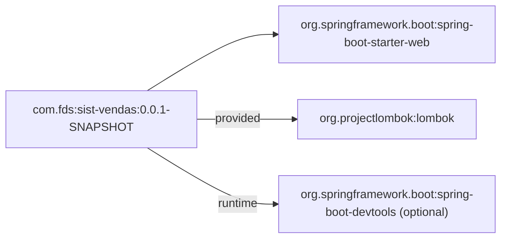
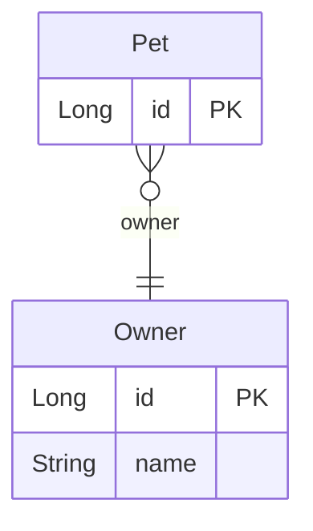

# HORUS

# assis-pom

Extract Maven dependencies from a `pom.xml` and render them as a Mermaid diagram.

Part of the **Horus** project. ASSIS turns Java source into UML (PlantUML);
`assis-pom` reads a project's `pom.xml` and produces a Mermaid `flowchart`
listing its direct dependencies.

> Prototype — see *Scope and limitations* below.

## Usage

`assis-pom` reads a `pom.xml`, prints a Mermaid diagram to stdout, and writes it
to `dependencies.mmd`. If no path is given, it looks for `pomFDS.xml` in the
current folder.

The generated `.mmd` can be rendered at the Mermaid Live Editor
(<https://mermaid.live>) or embedded in Markdown.

### Example output

## How it works

1. Reads `pom.xml` with the Maven XPP3 reader (`MavenXpp3Reader`, from
   `maven-model`) into a `Model` object.
2. Reads the project's direct dependencies (`model.getDependencies()`).
3. Renders a Mermaid `flowchart`: a root node for the project and one node per
   dependency. `scope` (test/runtime) becomes the edge label; `optional`
   dependencies are suffixed.

## Scope and limitations

Reads the **raw** `pom.xml` only. It does **not** yet:

- resolve the **effective POM** (parent inheritance, property/version resolution);
- read `<dependencyManagement>` or imported BOMs;
- resolve transitive dependencies.

# assis-er

`assis-er` reads Java sources, finds the JPA `@Entity` classes and writes a Mermaid
`erDiagram` to `entity-diagram.mmd`.

### Example output

### Scope and limitations

- Fields become attributes (`@Id` → `PK`); `static`, `transient` and `@Transient` fields are skipped.
- Generic types use `~` (`List<String>` → `List~String~`); package names are dropped.
- `@ManyToOne`, `@OneToMany`, `@OneToOne` and `@ManyToMany` become relationships with a fixed
  cardinality per annotation; the `mappedBy` side is not drawn twice.
- Java names only: `@Table` and `@Column` names are ignored.
- Constraints such as non-null foreign keys are ignored.
- Inheritance (`@MappedSuperclass`, `@Inheritance`) and embeddables are not supported yet.

See `docs/entity-diagram-plan.md` for the design and roadmap.
